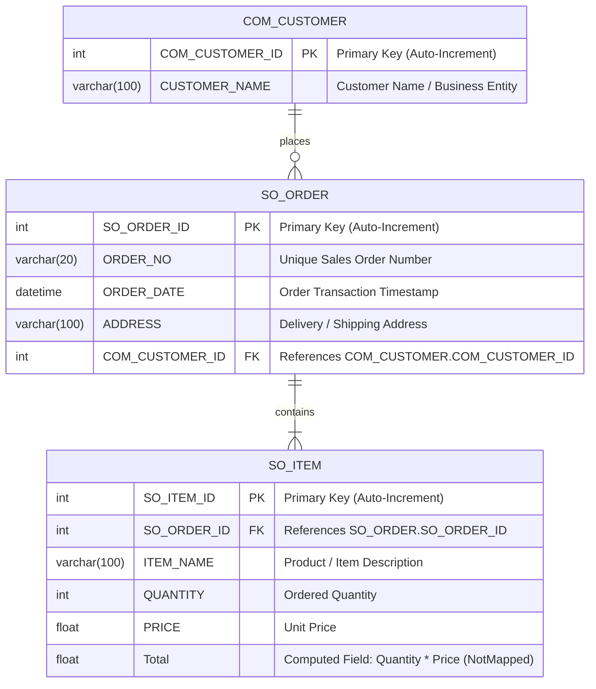

# SalesOrderApp (.NET 8)

[](https://dotnet.microsoft.com/)
[](https://learn.microsoft.com/en-us/dotnet/csharp/)
[](https://learn.microsoft.com/en-us/ef/core/)
[](https://www.microsoft.com/sql-server)
[](https://www.mysql.com/)
[](https://swagger.io/)
[](https://github.com/ClosedXML/ClosedXML)
[](LICENSE)

An enterprise-grade **Sales Order & Transaction Processing Management System** built with **ASP.NET Core 8**, **Entity Framework Core 8**, and a relational database backend (supporting both Microsoft SQL Server and MySQL). The system provides seamless order lifecycle tracking, customer management, itemized order lines, dynamic multi-parameter filtering, pagination, and automated Excel reporting.

---

## Table of Contents

- [Architectural Overview](#architectural-overview)
- [Database Schema & ERD](#database-schema--erd)
- [Key Features](#key-features)
- [REST API & Action Endpoints](#rest-api--action-endpoints)
- [Swagger / OpenAPI Documentation](#swagger--openapi-documentation)
- [Project Structure](#project-structure)
- [Getting Started](#getting-started)
  - [Prerequisites](#prerequisites)
  - [Database Configuration](#database-configuration)
  - [Applying Migrations](#applying-migrations)
  - [Running the Application](#running-the-application)
- [Exporting Reports](#exporting-reports)
- [License](#license)

---

## Architectural Overview

The application follows an enterprise **Controller-Service-Repository** pattern with Entity Framework Core serving as the Object-Relational Mapper (ORM) and Unit of Work manager:

- **Presentation Layer (ASP.NET Core MVC & Razor)**: Responsive client interface utilizing Bootstrap 5, client-side dynamic item row serialization, and server-rendered views.
- **Controller Layer (`Controllers/OrderController.cs`)**: Orchestrates inbound HTTP requests, manages validation through `ModelState`, coordinates with the database context, and returns appropriate views or binary file streams.
- **Data & Persistence Layer (`Data/AppDbContext.cs`)**: Leverages EF Core DbContext to enforce entity relationships, seed default master data, and execute optimized SQL queries.
- **Domain Models (`Models/`)**: Clean domain entities (`Customer`, `Order`, `OrderItem`) mapped to relational database tables with explicit data annotations (`[Table]`, `[Column]`, `[Key]`, `[Required]`).
- **Reporting Engine**: In-memory Excel generation using `ClosedXML.Excel` (`XLWorkbook`) to stream structured spreadsheets without filesystem clutter.

---

## Database Schema & ERD

The relational database schema is structured into three primary tables: `COM_CUSTOMER`, `SO_ORDER`, and `SO_ITEM`.



### Relational Constraints & Data Dictionary

| Table | Column | Type | Nullable | Description |
|---|---|---|---|---|
| `COM_CUSTOMER` | `COM_CUSTOMER_ID` | `INT` | No | Primary Key, Identity |
| `COM_CUSTOMER` | `CUSTOMER_NAME` | `VARCHAR(100)` | No | Customer organization name |
| `SO_ORDER` | `SO_ORDER_ID` | `INT` | No | Primary Key, Identity |
| `SO_ORDER` | `ORDER_NO` | `VARCHAR(20)` | No | Unique business order identifier |
| `SO_ORDER` | `ORDER_DATE` | `DATETIME` | No | Date of order placement |
| `SO_ORDER` | `ADDRESS` | `VARCHAR(100)` | Yes | Shipping / Billing address |
| `SO_ORDER` | `COM_CUSTOMER_ID` | `INT` | No | Foreign Key to `COM_CUSTOMER` |
| `SO_ITEM` | `SO_ITEM_ID` | `INT` | No | Primary Key, Identity |
| `SO_ITEM` | `SO_ORDER_ID` | `INT` | No | Foreign Key to `SO_ORDER` |
| `SO_ITEM` | `ITEM_NAME` | `VARCHAR(100)` | No | Item / product description |
| `SO_ITEM` | `QUANTITY` | `INT` | No | Unit count ordered |
| `SO_ITEM` | `PRICE` | `FLOAT` | No | Unit price per item |

---

## Key Features

- **Order Management (CRUD)**: Create new orders with multiple order line items, view order histories, and update existing orders.
- **Dynamic Line Items**: Dynamic client-side order item rows serialized into structured JSON upon form submission and hydrated into EF Core navigation collections.
- **Multi-Parameter Search & Filtering**: Real-time filtering across Sales Order Numbers, Customer Names, and formatted Order Dates (`dd/MM/yyyy`).
- **Server-Side Pagination**: Efficient `Skip()` and `Take()` database-level paging with configurable page sizes (default: 10 items/page).
- **ClosedXML Spreadsheet Export**: One-click generation of `.xlsx` reports preserving active search and date filters with formatted timestamp headers (`Orders_yyyyMMdd_HHmmss.xlsx`).
- **Dual DBMS Compatibility**: Native out-of-the-box configuration for Microsoft SQL Server (`Microsoft.EntityFrameworkCore.SqlServer`) and MySQL / MariaDB (`Pomelo.EntityFrameworkCore.MySql`).
- **Automated Master Seeding**: Automatically seeds initial customer entities (`Profescipta`, `Titan`, `Dips`) on migration execution.

---

## REST API & Action Endpoints

The application exposes the following action endpoints:

| Method | Endpoint | Query / Body Parameters | Description | Response Type |
|---|---|---|---|---|
| `GET` | `/Order` or `/Order/Index` | `searchQuery` (str), `orderDate` (str), `pageNumber` (int), `pageSize` (int) | Retrieves paginated and filtered list of sales orders | `text/html` (Razor View) |
| `GET` | `/Order/OrderForm` | `orderId` (optional int) | Loads blank order form or populates existing order with line items for editing | `text/html` (Razor View) |
| `POST` | `/Order/SaveOrder` | `Order` (model), `orderItemsJson` (json string) | Validates and persists order header and line items transactionally | `302 Redirect` to `/Order` |
| `GET` | `/Order/ExportToExcel` | `searchQuery` (str), `orderDate` (str) | Exports filtered order records to Microsoft Excel `.xlsx` | `application/vnd.openxmlformats-officedocument.spreadsheetml.sheet` |

---

## Swagger / OpenAPI Documentation

For environments utilizing RESTful API endpoints or when extending controllers for headless consumption:

1. **Swagger UI Access**:
   When Swagger middleware is activated in development mode, access the interactive API explorer at:
   ```
   https://localhost:7084/swagger
   ```
   or
   ```
   http://localhost:5242/swagger
   ```

2. **Enabling Swagger in `Program.cs`**:
   To enable Swagger / OpenAPI support in ASP.NET Core:
   ```csharp
   // 1. Register OpenAPI services
   builder.Services.AddEndpointsApiExplorer();
   builder.Services.AddSwaggerGen();

   // 2. Configure HTTP request pipeline
   if (app.Environment.IsDevelopment())
   {
       app.UseSwagger();
       app.UseSwaggerUI(c =>
       {
           c.SwaggerEndpoint("/swagger/v1/swagger.json", "SalesOrderApp API v1");
       });
   }
   ```

---

## Project Structure

```plaintext
SalesOrderApp/
├── Controllers/
│   └── OrderController.cs           # Order orchestration, filtering, pagination, and Excel export
├── Data/
│   └── AppDbContext.cs              # EF Core context, entity sets, and seed data configuration
├── Models/
│   ├── Customer.cs                  # Customer domain entity (COM_CUSTOMER)
│   ├── Order.cs                     # Sales Order header entity (SO_ORDER)
│   ├── OrderItem.cs                 # Order line item entity (SO_ITEM)
│   └── ErrorViewModel.cs            # Error view presentation model
├── Views/
│   ├── Order/
│   │   ├── Index.cshtml             # Order list, search filters, and pagination UI
│   │   └── OrderForm.cshtml         # Create/Edit order form with dynamic item table
│   └── Shared/
│       ├── _Layout.cshtml           # Base responsive layout
│       └── _ValidationScriptsPartial.cshtml
├── Properties/
│   └── launchSettings.json          # Local runtime profiles and port assignments
├── wwwroot/                         # Static assets (Bootstrap, jQuery, custom CSS/JS)
├── appsettings.json                 # Connection strings and application logging
├── SalesOrderApp.csproj             # Project configuration and NuGet package references
├── SalesOrderApp.sln                # Solution file
├── .gitattributes                   # GitHub Linguist language detection overrides
├── .gitignore                       # Standard .NET / Visual Studio ignore rules
├── LICENSE                          # MIT License
└── README.md                        # Enterprise architecture and setup documentation
```

---

## Getting Started

### Prerequisites

- [.NET 8.0 SDK](https://dotnet.microsoft.com/download/dotnet/8.0) or higher
- [SQL Server](https://www.microsoft.com/sql-server) (2019/2022/LocalDB/Express) **OR** [MySQL](https://www.mysql.com/) (8.0+)
- [.NET EF Core CLI Tool](https://learn.microsoft.com/en-us/ef/core/cli/dotnet) (`dotnet tool install --global dotnet-ef`)

### Database Configuration

Update the connection string in `appsettings.json` according to your target database:

#### Microsoft SQL Server (Default)
```json
{
  "ConnectionStrings": {
    "DefaultConnection": "Server=localhost;Database=SalesOrderDB;Trusted_Connection=True;TrustServerCertificate=True;MultipleActiveResultSets=true"
  }
}
```

#### MySQL / MariaDB (Alternative)
```json
{
  "ConnectionStrings": {
    "DefaultConnection": "Server=localhost;Database=sales_order;User=root;Password=your_password;"
  }
}
```
> *To switch to MySQL in `Program.cs`, replace `options.UseSqlServer(...)` with `options.UseMySql(connectionString, ServerVersion.AutoDetect(connectionString))` using Pomelo EF Core provider.*

### Applying Migrations

Apply Entity Framework Core database updates to create the schema and seed default customers:

```bash
# Restore NuGet dependencies
dotnet restore

# Apply migrations to database
dotnet ef database update
```

*(Optional) To add a new migration:*
```bash
dotnet ef migrations add InitialCreate
```

### Running the Application

Start the local Kestrel development server:

```bash
dotnet run
```

Or run with hot-reload:

```bash
dotnet watch run
```

Navigate to `https://localhost:7084` or `http://localhost:5242` in your web browser.

---

## Exporting Reports

The application provides integrated Excel report generation powered by **ClosedXML**:
1. Apply any search criteria (Order Number, Customer Name, or Date) in the Orders dashboard.
2. Click the **Export to Excel** button.
3. The server generates and streams a binary `.xlsx` workbook containing the filtered dataset, complete with numbered rows, order headers, timestamps, and customer associations.

---

## License

This project is licensed under the **MIT License** - see the [LICENSE](LICENSE) file for details.
